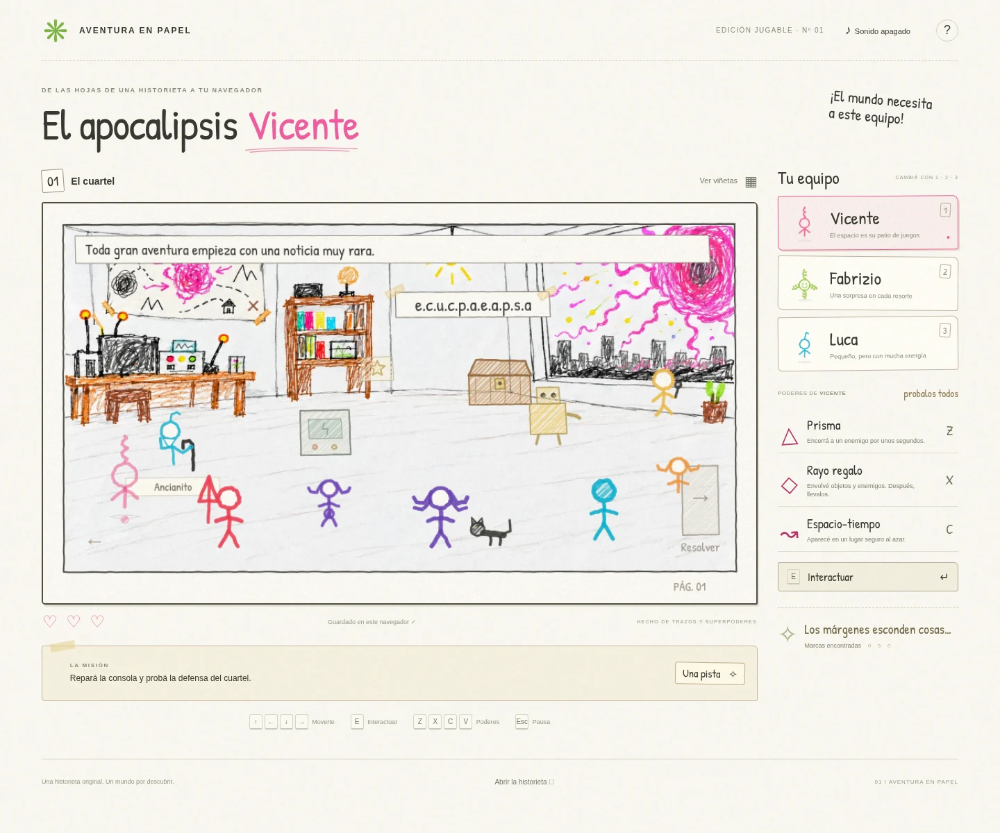

# El apocalipsis Vicente

Una aventura 2D para navegador basada en la historieta de la carpeta [`historieta/`](historieta/). Vicente, Fabrizio y Luca exploran viñetas, combinan once poderes y rescatan a Vicente de su propio apocalipsis. Incluye seis pantallas principales, una viñeta secreta que desbloquea a Gaspar, el rescate opcional de Amaral y la historieta original con tapa para leer dentro del juego.

## Jugar

**[Entrar en El apocalipsis Vicente](https://juanwinograd.github.io/Aventura-Papel/)**

El juego está publicado en GitHub Pages. Se juega gratis desde el navegador, sin instalar nada ni crear una cuenta. La primera versión está pensada para **una persona en computadora, con teclado y mouse**.

Elegí «¡Entrar en la historieta!» para empezar o «Continuar mi aventura» para recuperar una partida guardada. Podés activar los efectos de sonido con el botón ♪ y pedir «Una pista» cuando necesites ayuda.



## La aventura

Un meteoro convierte a Vicente en una enorme masa rosa que absorbe todo. Una pequeña esencia suya logra escapar: junto con Fabrizio y Luca deberá recuperar las esencias y salvar el mundo. La historia adapta las ideas de la historieta original para convertirlas en una aventura de exploración y acertijos, con peleas cómicas y una fiesta al final.

| Personaje | Poderes |
| --- | --- |
| Vicente | Encerrar enemigos en prismas, convertir objetos y enemigos en regalos transportables y teletransportarse fuera de peligro. |
| Fabrizio | Crear cubos que reflejan ataques, volverse invisible, lanzar picos y armar una fiesta subterránea. |
| Luca | Invocar rayos eléctricos, crear tormentas, proteger con un campo de fuerza y hacerse chiquito para entrar en pasadizos. |

Podés cambiar entre los tres durante la aventura. Al reunir las tres estrellas y entrar al nivel secreto, desbloqueás a **Gaspar** para todas las viñetas: brazo elástico, superpuño, teletransporte y **Papapumba**, una papa explosiva. Su desafío consiste en alcanzar una llave lejana y vencer a dos asistentes. Después, podés volver a la **viñeta 1** con Gaspar y usar su brazo elástico (Z) para abrir el cofre y liberar a **Amaral**, que queda disponible con **5** para toda la aventura. Sus climas afectan toda la pantalla: neblina (Z) que oculta al equipo de los enemigos, sol (X) que despeja e ilumina y viento (C) que desvía los disparos. Cada clima reemplaza al anterior, dura unos segundos y tiene recarga.

Los poderes se recargan solos; al perder volvés al punto de control, conservando los acertijos resueltos. La masa rosa crece al avanzar la historia, sin reloj: tocarla devuelve inmediatamente al punto de control, incluso usando un escudo. En la viñeta 4 bloquea el camino completo: después de resolver la placa y el robot hay que usar C de Vicente para llegar a la salida. En la calle, el láser solo deja cruzar a Fabrizio invisible, que puede llevar el regalo mientras lo atraviesa.

En el desenlace, Sebástian camina hacia la masa y se fusiona; después hay que hablar con el Ancianito para que los separe y reúna a Vicente con su cuerpo. La fiesta de Fabrizio ilumina toda la pantalla y hace bailar a los personajes del cierre. Alma (cara flotante suave), Alma (violeta), Seshia, Sofía y Cata acompañan en el cuartel y la celebración. Al terminar la historia, la masa rosa desaparece también al volver a las viñetas anteriores; el cuartel final muestra el cielo tranquilo por la ventana y no tiene banderines.

## Jugar en desarrollo

Requiere Node.js 20 o posterior.

```sh
npm ci
npm run dev
```

El servidor escucha en el puerto **3000**. Se puede cambiar con `PORT=otro_puerto npm run dev`. Abrir la raíz del servidor en el navegador. El juego funciona con archivos estáticos; no requiere base de datos, cuenta, claves ni servicios externos. No requiere compilación para desarrollo ni paquetes que cargar desde un CDN.

También se puede generar una edición descargable del juego en un solo archivo:

```sh
npm run build
```

El resultado es `dist/El-apocalipsis-Vicente.html`, con código, dibujos, estilos, fuente y efectos incluidos. Se puede descargar y abrir en un navegador de escritorio. Esta edición contiene el juego; el lector de la tapa y las 12 páginas originales está disponible en la versión del repositorio para mantener pequeña la descarga.

En el entorno de Codex, si el caché habitual de npm no es escribible:

```sh
npm ci --cache /workspace/.cache/npm --ignore-scripts --no-audit --no-fund
```

## Controles

| Acción | Control |
| --- | --- |
| Moverse | Flechas, WASD o clic en el suelo |
| Elegir personaje | 1 Vicente, 2 Fabrizio, 3 Luca, 4 Gaspar y 5 Amaral al desbloquearlos; también sus tarjetas |
| Poderes | Z, X, C y V, o sus botones en el panel |
| Hablar, recoger, colocar o abrir regalos, avanzar | E o Espacio |
| Pausa y controles | Escape o botón de ayuda |

Los poderes apuntan en la última dirección de movimiento. Hay que mirar al objetivo y estar a su alcance. Las máquinas cercanas tienen prioridad para el rayo eléctrico. La tecla E muestra una acción contextual: al llevar un regalo, lo coloca si hay un mecanismo cerca y lo abre en los demás lugares. El tamaño pequeño y el campo de fuerza se cancelan pulsando su tecla otra vez. En el conducto no se puede crecer ni cambiar de personaje hasta salir.

«Una pista» ofrece ayuda específica para cada viñeta. «Ver viñetas» permite regresar a las pantallas desbloqueadas y buscar marcas pendientes. Explorá los márgenes para descubrir el nivel secreto; no hace falta encontrarlo para terminar la historia.

El progreso se guarda localmente en el navegador, al resolver acertijos o encontrar marcas. «Continuar mi aventura» restaura el último punto de control. Recargar no conserva objetos en tránsito ni efectos temporales: los objetos de acertijos pendientes vuelven a su sitio. Borrar los datos del navegador elimina el guardado. Si el navegador bloquea el almacenamiento, se informa en pantalla y se puede seguir jugando en esa pestaña. Nueva aventura pide confirmación antes de reemplazar el progreso.

Las partidas no se sincronizan entre computadoras o navegadores. El juego publicado y la edición HTML descargable también pueden tener guardados separados.

## Publicación en GitHub Pages

El sitio sirve los archivos estáticos de la raíz del repositorio. Para configurar la publicación en GitHub:

1. Abrir **Settings → Pages**.
2. En **Build and deployment**, elegir **Deploy from a branch**.
3. Seleccionar la rama **main**, carpeta **/ (root)**, y guardar.

Para publicar una actualización, validar los cambios e incorporarlos a `main`. GitHub Pages vuelve a desplegar el sitio automáticamente; se puede consultar el resultado en **Actions** o **Settings → Pages**. No hace falta ejecutar `npm run build` para esta modalidad: `index.html` carga directamente los módulos, estilos y recursos del repositorio. Ese comando genera la edición descargable, que está ignorada por Git.

La dirección pública es **https://juanwinograd.github.io/Aventura-Papel/**. Si se usa un fork o se cambia el nombre del repositorio, hay que actualizar este enlace. Los recursos del juego usan rutas relativas para funcionar bajo la carpeta del proyecto.

## Validación

```sh
npm run check
npm test
npm run test:browser
npm run build
npm run test:download
```

- `check`: verifica la sintaxis de los módulos y del servidor.
- `test`: pruebas del motor con el runner de Node; regalos y contenido, poderes, recargas, movimiento restringido, teletransporte seguro, protección de NPC, puntos de control, guardado, aventura completa y nivel secreto.
- `test:browser`: inicia su propio servidor en el puerto 3107 y recorre el juego en Chromium con clics y teclas reales. Comprueba los dieciocho poderes, el láser y el teletransporte obligatorio, el final con fusión y separación, las tres marcas, el nivel secreto de Gaspar, el cofre de Amaral y sus tres climas, la continuación del guardado, pausa, sonido y lectura de la tapa y las doce páginas de la historieta. También verifica los fondos ilustrados, la estabilidad del trazo entre fotogramas idénticos, las rutas bajo `/Aventura-Papel/` y la ausencia de desborde horizontal a 320, 390 y 768 px. Guarda capturas en `test-results/`, una carpeta ignorada por Git.
- `test:download`: verifica el HTML generado, el movimiento, un poder, el guardado y la continuación. Sirve el archivo en el puerto 3108, corta la conexión después de la carga y comprueba que no se pidan recursos externos. La política del Chromium administrado impide navegar a `file://`; la apertura directa desde el sistema de archivos no pudo verificarse aquí.

Las pruebas del navegador usan `/usr/bin/chromium` si existe, o el navegador instalado por Playwright. En otra máquina, ejecutar `npx playwright install chromium` antes de las pruebas. Se puede indicar un ejecutable con `CHROMIUM_PATH` y cambiar el puerto de prueba con `TEST_PORT`.

## Diseño y alcance

- [Diseño de la aventura](docs/diseno-juego.md).
- [Lámina visual aprobada](docs/propuesta-visual.png).
- `src/engine.js`: reglas y estado del juego, independiente del dibujo y del navegador.
- `src/content.js`: pantallas, diálogos, acertijos y poderes.
- `src/art.js`: personajes y escenarios dibujados en Canvas, conservando las formas aprobadas.
- `src/sketch.js`: contornos de lápiz, rellenos a rayitas y grano de papel; las marcas se reutilizan para que el trazo permanezca estable al animarse.
- `assets/illustrations/`: fondos del cuartel, la calle, el laboratorio, el borde, el desenlace y el nivel secreto, además de versiones del cuartel y la calle después del rescate, junto con la masa rosa transparente. Se generaron tomando el arte aprobado como referencia visual. La fiesta usa el cuartel con la ventana despejada.
- `src/illustration-files.js`: lista de fondos, compartida por la aplicación y el generador del HTML descargable. El generador incluye las imágenes dentro del archivo para conservar el funcionamiento sin conexión.
- `src/app.js`: interfaz, controles, guardado y lectura de la tapa y las doce páginas de la historieta.
- `src/audio.js`: efectos breves sintetizados con Web Audio.

Vicente y Luca flotan sin piernas. Luca tiene un solo pelo doblado. Fabrizio tiene un resorte de pelo, uno de pierna y dos de brazos. El Ancianito tiene una pequeña barba y sostiene su bastón; Gaspar conserva la cara redonda con extremidades radiales de su dibujo. Amaral es roja y sostiene una lanza; Alma es una cara flotante de color suave. El rombo celeste de la referencia queda fuera del juego por ahora; las cinco chicas mantienen sus siluetas y colores. Fusi conserva el pelo y la cabeza abierta del glosario, diferenciada de sus asistentes. Fusi y Cata flotan sin piernas. Las estrellas secretas se dibujan sobre los escenarios y efectos para que sean visibles, sin recuadros. El blanco conserva su fondo claro; las indicaciones para el láser y el cerrojo las da el Ancianito. La antena conserva su dibujo sin círculo blanco y está separada de los muebles. Los dibujos originales no se modifican. La tipografía Patrick Hand está incluida bajo su licencia OFL en `assets/FONT-LICENSE.txt`.

Primera versión para una persona en computadora con teclado y mouse. La interfaz se adapta a pantallas angostas, pero no incluye controles táctiles completos ni multijugador. La duración de 10–15 minutos es un objetivo de diseño que debe ajustarse con una partida de la familia; las pruebas automáticas no miden esa experiencia.
